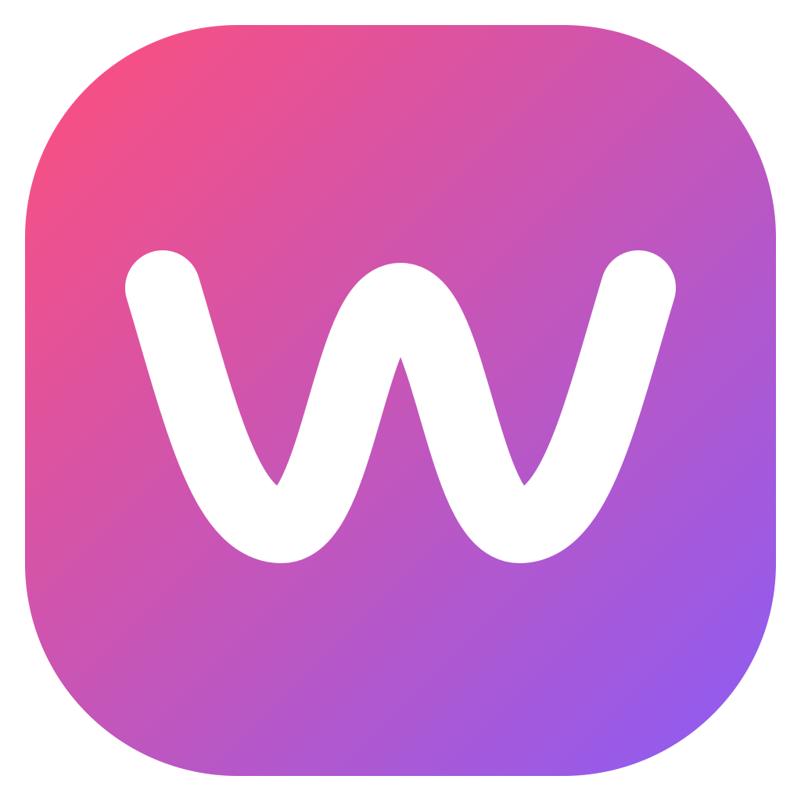

<p align="center">
  
</p>

<h1 align="center">Wavely</h1>

<p align="center">
  Leichtgewichtiger Desktop-Musikplayer für Windows mit eigenem Design –<br />
  lokale Musik, YouTube Music, Spotify und SoundCloud in einer App, mit Discord Rich Presence.
</p>

---

## Funktionen

### Musikquellen
- **Lokale Musik:** Ordner hinzufügen; MP3, FLAC, M4A, OGG, OPUS und WAV werden mit Titel, Künstler, Album und Cover eingelesen.
- **YouTube Music:** Anmeldung mit Google, Playlists, Alben, Lieblingssongs, Suche und Künstlerseiten. Songs liken, Playlists erstellen und Songs hinzufügen. Gehörte Songs landen auf Wunsch im YouTube-Verlauf.
- **Spotify:** Anmeldung, Lieblingssongs, Playlists, Alben, Suche, Künstler und Verlauf.
  - **Premium:** echte Spotify-Wiedergabe direkt in Wavely (Web Playback SDK) und Wechsel auf andere Geräte (Spotify Connect).
  - **Free:** Wiedergabe über den passenden Song auf YouTube Music.
- **SoundCloud:** Anmeldung, Likes, Playlists, Alben, gefolgte Künstler, Suche und Künstlerseiten. 30-Sekunden-Ausschnitte (Go+) laufen über YouTube Music in voller Länge.

### Player
- Eigener Player für alle Quellen: Zufall, Wiederholen, Warteschlange und Autoplay mit passenden Songs
- Synchronisierte Liedtexte (LRCLIB, sonst YouTube Music)
- Verlauf für Wavely, YouTube Music, Spotify und SoundCloud
- Offline-Modus: Songs und Playlists herunterladen und ohne Internet hören
- Mini-Player: frei skalierbar, optional immer im Vordergrund

### Windows & Discord
- **Discord Rich Presence:** „Hört …“ mit Titel, Künstler, Cover und Fortschritt
- **Medientasten** und Windows-Medienanzeige mit Cover
- **Taskleisten-Vorschau** mit Zurück, Play/Pause, Weiter und Gefällt mir
- Helles und dunkles Design, frei wählbare Akzentfarbe, einklappbare Seitenleiste

## Installation

Den Installer `Wavely_<version>_x64-setup.exe` ausführen. Wavely aktualisiert das mitgelieferte yt-dlp einmal am Tag selbst.

### Spotify Premium

Spotify verlangt seit 2026, dass der Inhaber einer Entwickler-App selbst Premium hat (maximal 5 Nutzer pro App). Für die Premium-Wiedergabe:

1. Auf [developer.spotify.com](https://developer.spotify.com/dashboard) eine App anlegen
   - Redirect URI: `http://127.0.0.1:43827/callback`
   - APIs: **Web API** und **Web Playback SDK**
   - Unter *User Management* die E-Mail-Adresse des Spotify-Kontos eintragen
2. In Wavely unter **Einstellungen → Spotify → Eigene Spotify Client ID** die Client ID eintragen
3. Bei Spotify anmelden

## Selbst bauen

Voraussetzungen: [Rust](https://rustup.rs), [Node.js](https://nodejs.org) und die Visual Studio Build Tools mit „Desktopentwicklung mit C++“.

```bash
npm install
```

`npm install` lädt auch yt-dlp (mit Prüfsummen-Kontrolle) nach `src-tauri/binaries`.

```bash
npm run dev
```

Installer bauen (landet in `src-tauri/target/release/bundle/nsis/`):

```bash
npm run build
```

## Aufbau

Gebaut mit [Tauri 2](https://tauri.app) (Rust) und [Svelte 5](https://svelte.dev).

| Pfad | Zweck |
| --- | --- |
| `src/components/` | Oberfläche: Ansichten, Player-Leiste, Mini-Player, Einstellungen |
| `src/lib/player.svelte.js` | Wiedergabe, Warteschlange, Autoplay, Verlauf, Discord-Updates |
| `src/lib/spotifyPlayer.svelte.js` | Spotify-Premium-Wiedergabe und Geräteauswahl |
| `src/lib/bridge.svelte.js` | Verbindung zu Taskleiste, Medientasten und Mini-Player |
| `src/app.css` | Design-Tokens (Farben, Abstände) |
| `src-tauri/src/ytm.rs` | YouTube Music: Anmeldung, Bibliothek, Suche, Stream-Proxy, Verlaufsmeldung |
| `src-tauri/src/spotify.rs` | Spotify: Anmeldung (PKCE), Web API, Zuordnung zu YouTube Music |
| `src-tauri/src/soundcloud.rs` | SoundCloud: Anmeldung, Bibliothek, Suche, Streams |
| `src-tauri/src/library.rs` | Lokale Ordner durchsuchen, Tags und Cover lesen |
| `src-tauri/src/offline.rs`, `ytdlp.rs` | Downloads und yt-dlp (mit täglichem Selbst-Update) |
| `src-tauri/src/presence.rs` | Discord Rich Presence |
| `src-tauri/src/media.rs`, `taskbar.rs` | Windows-Medientasten und Taskleisten-Buttons |
| `src-tauri/src/artwork.rs`, `lyrics.rs` | Cover-Zwischenspeicher und Liedtexte |
| `src-tauri/vendor/rustypipe` | Gepatchte Kopie von RustyPipe (siehe `vendor/README.md`) |

## Lizenz-Hinweis

Wavely nutzt [RustyPipe](https://codeberg.org/ThetaDev/rustypipe) (GPL-3.0). Wird Wavely weitergegeben, muss es daher ebenfalls unter GPL-3.0 stehen und der Quellcode verfügbar sein. yt-dlp steht unter der Unlicense.

Wavely ist ein privates Projekt und steht in keiner Verbindung zu YouTube, Spotify, SoundCloud oder Discord.
